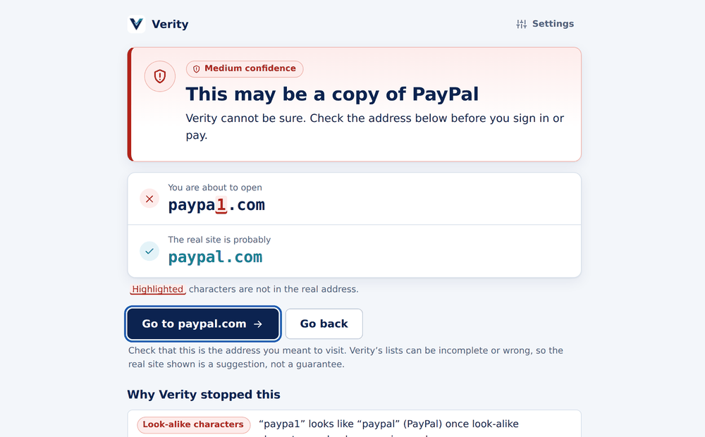
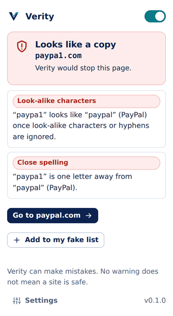

<p align="center">
  
</p>

<h1 align="center">Verity</h1>

<p align="center">
  A browser extension that warns you when a website looks like a copy of a well-known one<br>
  and shows you the real address. Checks run on your device.
</p>

<p align="center">
  <a href="https://github.com/NurAbir/verity/actions/workflows/ci.yml"></a>
  <a href="LICENSE"></a>
</p>

> **Verity is a helper, not a guarantee.** It looks at web addresses only. It can flag a genuine site by mistake
> and it can miss a dangerous one. No warning does not mean a site is safe.

**Contents:** [Features](#features) · [Install](#install) · [How it works](#how-it-works) · [Data sources](#data-sources) · [Privacy](#privacy) · [Architecture](#architecture) · [Development](#development) · [Contributing](#contributing)

For everyday use, see the **[user manual](USER_MANUAL.md)**.

## Features

- Detects look-alikes: same name with a different ending (`something.site` vs `something.com`), swapped characters (`paypa1`), typos, brand plus extra words (`paypal-login`), and brand names hidden in subdomains.
- Your own **fake → real** list, with import and export.
- Uses the lists that uBlock Origin users know: **Badware risks** and the **Phishing URL Blocklist** (optionally **Phishing.Database** too), plus reported scam sites and a top-1M popularity list.
- Warning page that highlights exactly which characters differ, explains why, and says how sure it is. Light and dark themes, keyboard friendly.
- Toolbar popup with a status for the current page, an on/off switch, and one-click "add to my fake list".
- One-button list updates (optional weekly updates), minimal permissions, no analytics, no dependencies.

<table>
  <tr>
    <td></td>
    <td></td>
  </tr>
</table>

## Install

Requires Chrome, Edge or Brave, and Node.js 20.12 or newer.

```
git clone https://github.com/NurAbir/verity.git
cd verity
npm run build
```

Open `chrome://extensions`, turn on **Developer mode**, choose **Load unpacked**, and select the `extension` folder.
`npm run build` downloads the reference lists; you can also press **Update lists now** in the extension's settings.

## How it works

`core/verdict.js` runs these layers in order; the first that decides wins.

| # | Layer | Result |
|---|---|---|
| 1 | Not a normal website (IP address, localhost, `chrome://`) | ignore |
| 2 | Protection switched off | ignore |
| 3 | You chose to trust the site | ignore |
| 4 | Your own fake list | danger |
| 5 | Official domain of a curated brand | ignore |
| 6 | Popular site (top 1M) | ignore |
| 7 | Reported scam sites (brand known, so the real site is offered) | danger |
| 8 | Public filter lists | danger |
| 9 | Look-alike rules | warning or caution |

**Look-alike rules:** same name with another ending, look-alike characters (`paypa1`, `pay-pal`, `rn` for `m`), one or two letters off, brand name plus extra words (a risk word such as `login` raises it), brand name in the subdomain (`paypal.com.secure-check.xyz`), and international characters. Hand-curated brands can cause a full warning; names taken from the popularity list only cause a badge. A site that appears in the larger "known to exist" list (ranks 1M–3M) is judged one step more gently.

**Safeguards:** every warning states that Verity can be wrong and how sure it is; "open anyway" needs a confirmation and lasts one hour; the real site is a suggestion, never opened automatically; notices appear when lists are missing or older than 30 days; if anything breaks, browsing continues untouched; popular sites are never blocked because of a list entry.

## Data sources

| Source | Used for | Licence |
|---|---|---|
| [Tranco](https://tranco-list.eu) top 1M and full list | Popular sites (trusted tier), the 1M–3M "known to exist" tier, brand-like names | MIT; combines rankings that carry their own terms (some non-commercial) |
| [phishunt.io](https://phishunt.io) feed | Reported scam sites mapped to a brand | CC0 per its API page; check its terms |
| [uBlock Origin "Badware risks"](https://github.com/uBlockOrigin/uAssets) | Fake and look-alike download sites (e.g. clones of VLC, Audacity, 7-Zip) | GPL-3.0 |
| [Phishing URL Blocklist](https://gitlab.com/malware-filter/phishing-filter) (curben) | Phishing sites, built from PhishTank, OpenPhish and phishunt | CC BY-SA 4.0 |
| [Phishing.Database](https://github.com/Phishing-Database/Phishing.Database) (optional "Extra coverage") | About 390,000 more active phishing domains. Off by default: the download is about 11 MB per update | MIT |
| `extension/data/brands.json` | Curated brands and their real domains (a starter list: verify and extend it) | MIT |

Lists are downloaded when you build or update; they are not stored in this repository. Only whole-site entries are used from filter lists (`||example.com^`, hosts files, plain domains). Cosmetic filters, regex, paths and sub-request rules are skipped. Checked against the real "Badware risks" file: 3,301 whole-site entries from about 6,900 lines.

**Considered and not included by default**

| Source | Why not |
|---|---|
| EasyList, EasyPrivacy | Block ads and trackers, not fake sites |
| uBlock "Online Malicious URL Blocklist" (URLhaus) | Malware distribution, not look-alike sites; easy to add later |
| PhishTank, OpenPhish | Already inside the Phishing URL Blocklist; direct use has separate terms |

**Generated files** in `extension/data/` (git-ignored): `trusted.bin`, `extended.bin` (Tranco), `toplabels.json`, `feed.json` (scam reports and the list of filter lists), `bl-<id>.bin` (one per filter list), `meta.json`.

## Privacy

Verity checks addresses on your device and sends nothing about the sites you visit. It contacts the internet only to download public lists, and only when you press **Update lists now** or turn on weekly updates.

| Data | Where it is stored |
|---|---|
| Settings, your fake list, sites you trust | `chrome.storage.local` (not synced) |
| Last update result | `chrome.storage.local` |
| Downloaded lists | IndexedDB `verity-lists` |
| Bundled lists | `extension/data/` |

**Addresses contacted** (defined in `extension/src/config.js`, matched by the manifest, checked by a test): `tranco-list.eu`, `phishunt.io`, `ublockorigin.github.io`, `curbengh.github.io`, and `raw.githubusercontent.com` only if you turn on Extra coverage. Chrome is asked for exactly the sites that are switched on. Requests carry no cookies and no referrer. These servers can see your IP address, like any download. There are no analytics, accounts or crash reports.

| Permission | Why |
|---|---|
| `webNavigation` | See the address of a page as it opens and stop it if it looks like a copy. Not stored. |
| `storage` | Save your settings and lists. |
| `activeTab` | Let the toolbar popup read the address of the tab you click it on. |
| `alarms` | The optional weekly update. |
| Optional access to those sites | Asked only when you first update; revoke any time in `chrome://extensions`. |

There are no content scripts: Verity never reads page content, forms, passwords or cookies. Removing the extension deletes everything it stored.

## Architecture

```
verity/
├── .github/
│   ├── assets/                README screenshots
│   ├── ISSUE_TEMPLATE/        bug report, wrong or missed warning
│   └── workflows/ci.yml       tests on Windows and Linux, packaging check
├── extension/                 the shipped extension (load this folder)
│   ├── manifest.json
│   ├── data/                  brands.json (curated) + generated lists (git-ignored)
│   ├── icons/                 logo and toolbar icons
│   ├── pages/                 warning, popup, settings (HTML, CSS, ES modules; no build step)
│   └── src/
│       ├── config.js          limits and the only network addresses
│       ├── core/              pure logic, no browser APIs (unit-tested in Node)
│       ├── background/        thin adapters: service worker, storage, IndexedDB, updates
│       └── updater/           in-browser list updater (fetch and storage are injected)
├── scripts/                   build-data, build-feed, pack
├── test/                      node:test suites
├── CHANGELOG.md  CONTRIBUTING.md  LICENSE  SECURITY.md  USER_MANUAL.md
└── package.json  .editorconfig  .gitattributes  .gitignore
```

**Principles:** the decision is one pure function; browser APIs live at the edges; fail open; one source of truth (the CLI scripts and the in-browser updater share the same build code, and network addresses exist only in `config.js`); every finding carries a plain-language reason.

| Module | Role |
|---|---|
| `core/verdict.js` | the decision pipeline |
| `core/lookalike.js` | brand index and look-alike rules |
| `core/blocklist.js` | reads uBlock-style filter lists, matches hosts and their parents |
| `core/state.js` | every user-state change as a pure function |
| `core/hostname.js` | registrable-domain split (built-in suffix table), input validation |
| `core/domainset.js`, `hash.js` | packed sorted hash sets with binary search |
| `core/datasets.js`, `feed.js`, `zip.js`, `diff.js` | list building, zip parsing, character diff |
| `background/service-worker.js` | navigation listener, badge, weekly alarm, messages |
| `background/storage.js`, `datastore.js`, `listdb.js`, `update-runner.js` | persistence, list loading, IndexedDB, update glue |
| `updater/updater.js` | download, build and save lists |

**Formats.** A domain set ("VDS1") is the magic `VDS1`, version, key size (5), reserved, a big-endian count, then sorted 5-byte hashes (cyrb53 truncated to 40 bits, `core/hash.js`). 1M domains take about 5 MB. Changing the hash invalidates every data file. `chrome.storage.local` holds `verity` (`{schemaVersion, settings, userList, allowlist}`, repaired by `migrate()` on every read) and `verity-update-status`. IndexedDB `verity-lists/lists` holds `trusted`, `extended`, `toplabels`, `feed`, `meta` and `bl-<id>`. A brand entry is `{ id, name, domains[], aliases[]? }`; the first domain is offered as the real site.

**Updates.** *Update lists now* asks for permission (it must be the first await so Chrome counts it as a click), then downloads Tranco, the phishunt feed and each filter list (mirrors tried in order), builds them, and writes everything that succeeded in one IndexedDB transaction. A failed step keeps its old data; an implausibly small download is refused.

**Security model.** Text is inserted as text, never HTML (a test forbids `innerHTML`). The warning page asks the worker for the verdict instead of trusting its URL, and only navigates to validated plain domains. Messages are accepted only from the extension's own pages. No content scripts, no install-time host permissions, strict CSP, no remote code.

**Design decisions.** `webNavigation` + `tabs.update` instead of `declarativeNetRequest`, because look-alike logic is code, not a fixed URL list (trade-off: Manifest V3 cannot block synchronously, so the first request may start before the redirect). Hashes instead of domain text, to keep 1M domains at about 5 MB. Only hand-curated brands can cause a full warning, to limit false alarms. The long tail of the ranking is never fully trusted because it contains spam.

## Development

Node.js 20.12 or newer. There are no dependencies, so `npm install` is not needed.

| Command | Purpose |
|---|---|
| `npm test` | All tests |
| `npm run build` | `build:data` (Tranco lists) and `build:feed` (scam reports and filter lists) |
| `npm run pack` | `dist/verity-<version>.zip` from `extension/` |

Offline builds (add `--extended true` to `build-feed` for Phishing.Database): `node scripts/build-data.mjs --trusted top.csv --full full.csv` and `node scripts/build-feed.mjs --from feed.json --lists-dir ./lists` (files named `<id>.txt`).
**Debugging:** `chrome://extensions` → Verity → "service worker" for the worker console; right-click a Verity page → Inspect; DevTools → Application → IndexedDB for downloaded lists.

**Code rules.** Plain ES modules, no bundler, no dependencies. Logic goes in `core/` as pure functions with tests. Never use `innerHTML`. No new network address outside `config.js`, no new permission without discussion (tests check both). User-facing text is plain English and never promises safety.

**Adding things.** *Brand:* edit `extension/data/brands.json` and verify the domains by hand. *Rule:* add it to `findLookalikes`, give it a reason and a level, add cases to `test/verdict.test.mjs`. *Source:* add it to `config.js` (`BLOCKLISTS` for filter lists) and `optional_host_permissions` in the manifest, with tests; a test checks that they agree. *Wrong warning:* write the failing test first, then fix.

**Manual test before a release** (safe, visits no scam site):
1. Load unpacked; the settings page opens with the notice. Tick the acknowledgement.
2. Add `example.net` as a fake of `example.com`. Open `https://example.net`: the warning shows the differing characters, and "Go to example.com" works.
3. "Open this site anyway" stays disabled until the box is ticked; "Open for one hour" opens the site, and it appears under "Sites I chose to trust".
4. On a normal page the popup says nothing unusual and offers "Add to my fake list".
5. Switch protection off: no warnings. Switch it on again.
6. **Update lists now**: permission prompt, every step succeeds, the sources table lists the filter lists and says "Using lists you downloaded". Turn on **Extra coverage** and update again: Phishing.Database appears. **Use the lists that came with Verity** reverts it.
7. Export, remove an entry, import: the entry returns. Reload the extension: settings persist.

**Releasing.** Update `CHANGELOG.md`; set the same `version` in `package.json` and `extension/manifest.json` (a test checks); run `npm test`, `npm run build`, `npm run pack`; do the manual test with the packed build; tag `v<version>` and attach `dist/verity-<version>.zip` to a release.

## Contributing

See [CONTRIBUTING.md](CONTRIBUTING.md). The most useful contribution is a report of a wrong or missed warning (issue template provided). Report vulnerabilities privately, see [SECURITY.md](SECURITY.md).

## Licence

Code: [MIT](LICENSE). The data sources have their own licences, see [Data sources](#data-sources). Verity is not affiliated with any brand it protects.
